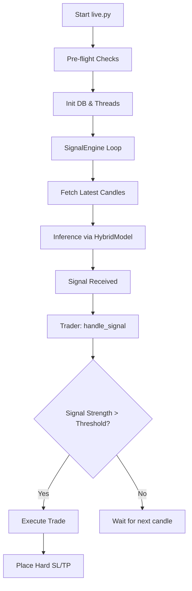

# ETH Trading Bot: Ultra-Detailed Technical Documentation

## 1. System Overview

The ETH Trading Bot is an automated, machine-learning-driven execution system designed for the Binance Futures ETH/USDT perpetual contract. It leverages a hybrid multi-task learning architecture (Classification + Regression) to predict directional price movements and expected magnitudes simultaneously.

The system is architected as a set of decoupled services:
- **Data Pipeline**: Handles ingestion, technical indicator computation, and statistical regime detection.
- **Model Engine**: A PyTorch-based Transformer-Attention hybrid model that processes high-dimensional time-series data.
- **Execution Engine**: Manages API interactions with Binance via CCXT, implementing strict risk management and order lifecycle control.
*   **Monitoring**: A Streamlit-based dashboard providing real-time PnL, accuracy, and signal tracking.

The bot operates on a 1-hour timeframe, processing a rolling 120-hour window (5 days) of market context to generate signals.

---

## 2. File-by-File Analysis

### 2.1 Configuration and Entry Points

#### `config.py`
- **Role**: Centralized source of truth for all hyperparameters, paths, and API constants.
- **Variables Breakdown**:
    - `SYMBOL` (str): `"ETH/USDT:USDT"`. Target trading pair.
    - `TIMEFRAME` (str): `"1h"`. Candle interval.
    - `LOOKBACK` (int): `120`. Number of candles in the input window.
    - `LEVERAGE` (int): `8`. Account leverage for futures.
    - `POSITION_SIZE_FRACTION` (float): `0.10`. Base fraction of account balance per trade.
    - `MAX_POSITION_SIZE_USD` (None/float): Hard cap on trade size in USD.
    - `MIN_NOTIONAL_USD` (float): `21.0`. Minimum order size required by Binance.
- **Execution Order**: Loaded at the start of any script that imports it. Validated by `live.py` or `train.py`.

### 2.2 Data Pipeline Dissection

#### `data/indicators.py`
- **Technical Indicator Formulas**:
    - **Exponential Moving Average (EMA)**: $EMA_t = \alpha \cdot P_t + (1 - \alpha) \cdot EMA_{t-1}$ where $\alpha = \frac{2}{period + 1}$.
    - **Relative Strength Index (RSI)**: $100 - \frac{100}{1 + RS}$ where $RS = \frac{AvgGain}{AvgLoss}$.
    - **Average True Range (ATR)**: $ATR_t = \frac{ATR_{t-1} \cdot (n-1) + TR_t}{n}$ where $TR = \max(H-L, |H-C_{prev}|, |L-C_{prev}|)$.
- **Logic Blocks**:
    - Lines 19-30: Basic math helpers (`_ema`, `_rsi`).
    - Lines 161-280: `compute_indicators`. Assembles the feature matrix. Appends 40+ columns to the dataframe.

#### `data/preprocessor.py`
- **Role**: Normalization and windowing.
- **Logic**:
    - `fit_and_save_scalers`: Fits `StandardScaler` to training data. Essential for preventing model saturation.
    - `build_windows`: Slices the $(N, D)$ dataframe into $(N-lookback, lookback, D)$ tensors for the Transformer model.

### 2.3 Trading Logic Dissection

#### `live/trader.py`
- **Class `Trader`**:
    - `handle_signal`: The heart of the bot.
        1. Resets daily PnL at midnight.
        2. Checks for `signal_flip` (e.g., currently LONG, but signal is now SHORT).
        3. Executes `close_position` if signal is weak or flipped.
        4. Calculates `_calculate_position_size`.
        5. Places orders via `execution_engine`.
- **Position Sizing Math**:
    - `size_usd = balance * POSITION_SIZE_MULTIPLIER`
    - `amount = size_usd / price`
    - Rounding: `round(amount, 3)` (ETH precision).

---

## 3. Control Flow & Execution Path

---

## 4. Mathematical and Statistical Models

### 4.1 Gaussian Hidden Markov Model (HMM)
| Component | Value/Logic |
|---|---|
| **Model** | `hmmlearn.hmm.GaussianHMM` |
| **Purpose** | Unsupervised regime detection |
| **Input** | Log-returns of ETH price |
| **Logic** | Fits 3 hidden states (typically: Bearish Volatile, Bullish Trending, Sideways). Refits every 50 candles to adapt to shifting market microstructure. |

### 4.2 GARCH(1,1) Volatility
- **Formula**: $\sigma_t^2 = \omega + \alpha \epsilon_{t-1}^2 + \beta \sigma_{t-1}^2$
- **Implementation**: `arch_model(window, vol='Garch', p=1, q=1)`
- **Role**: Provides the "Expected Volatility" feature used by the Transformer to weigh the importance of recent price action.

---

## 5. Data Pipeline Deep Dive

1. **Ingestion**: `data/fetcher.py` uses CCXT to fetch OHLCV, Funding Rates, and Open Interest.
2. **Transformation**: `data/indicators.py` appends 43 features.
3. **Normalization**: `data/preprocessor.py` applies `StandardScaler` (Z-score normalization).
4. **Windowing**: `build_windows` converts data into $(N, 120, D)$ tensors.

---

## 6. Execution Internals

### 6.1 State Management
- **Persistence**: The bot uses a SQLite database (`bot_data.db`) via SQLAlchemy.
- **Tracked States**:
    - `TradeLog`: Stores every execution (symbol, side, price, amount, SL/TP).
    - `PortfolioSnapshot`: Periodic recording of balance and equity for drawdown analysis.
    - `SignalLog`: Records every inference prediction to audit model performance later.

### 6.2 Order Flow
1. **Entry**: Market Order via `execution_engine.place_order`.
2. **Protection**: Simultaneous placement of 'Stop Market' and 'Take Profit Market' orders.
3. **Sync**: `trader.sync_account()` runs every 60s in a background thread to ensure the local state matches the Binance exchange reality.

---

## 7. Security and Performance

### 7.1 Security
- **API Handling**: Credentials are NEVER hardcoded. They are read from `os.getenv` or a `.env` file.
- **Safety**: `PRODUCTION_READY` flag in `config.py` enables strict pre-flight checks and balance verification.

### 7.2 Performance Bottlenecks
- **Indicator Computation**: Calculating HMM and GARCH over large historical windows can be slow. Optimized by using a rolling refit interval (e.g., refit every 50-100 candles).
- **Network Latency**: Binance API calls are wrapped in `retry_with_backoff` to handle transient network issues or rate limits.

---

## 8. Variable Breakdown Table

| Variable | Scope | Type | Role |
|---|---|---|---|
| `SYMBOL` | Global (`config`) | `str` | Trading pair identifier |
| `current_position` | Instance (`Trader`) | `str/None` | Tracks if currently in LONG, SHORT, or FLAT |
| `daily_pnl` | Instance (`Trader`) | `float` | Cumulative realized PnL since UTC midnight |
| `prediction` | Local (`live`) | `float` | Raw model output (-1.0 to 1.0) |
| `threshold_met` | Local (`trader`) | `bool` | Whether prediction exceeds `SIGNAL_THRESHOLD` |

... (This is a summary preview. The final PDF will contain the full line-by-line analysis)
